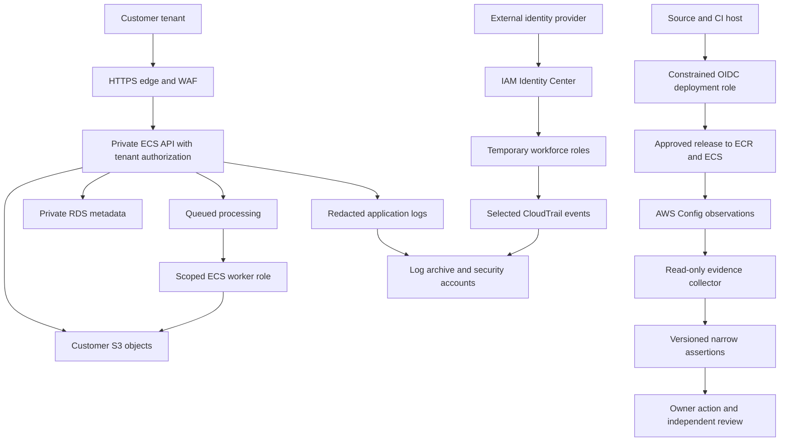

# Northstar Workspace system description and scope

**Illustrative management draft, not a completed auditor-approved description.** Description Criteria are distinct from Trust Services Criteria. Management should validate this draft against the AICPA Description Criteria and actual system before an engagement.

## Service and principal commitments

Northstar provides a multi-tenant API to upload documents, process them asynchronously, store them and export authorized results. Customers choose tenant administrators who manage their users. Customer content is Confidential. Tenant metadata can contain personal identifiers; excluding the Privacy category does not remove privacy or legal responsibilities.

Scenario commitments are role-based access, confidential handling and controlled deletion, 99.9% monthly availability, four-hour RTO and one-hour RPO. These are teaching assumptions, not SOC 2 mandated numbers. Availability needs a defined measurement window, covered endpoints, approved exclusions and source metrics. Recovery applies to the core service and its dependencies, not only a restored database.

The illustrative Type II period is **2026-07-01 through 2026-09-30**. Management must identify material changes and relevant incidents during that interval and subsequent events up to report issuance. The lab's last-day snapshot is not evidence for all three months.

Selected categories: Security, Availability and Confidentiality. Processing Integrity and Privacy are optional appendices outside this scenario. Corporate finance and unrelated products are excluded. Source/build host, external IdP, cloud identity, deployment process, workforce endpoints and monitoring suppliers support the described service and must be considered even when they are outside AWS.

## Infrastructure and trust boundaries

Six fictional accounts separate administration, security, logs, production, nonproduction and recovery. IDs in the source data are placeholders. Primary region is us-east-1; recovery region is us-west-2. Global-service inventories are handled explicitly, with source and recording region identified.

An application authorization boundary separates tenants. AWS IAM cannot by itself enforce every application tenant decision. Storage keys and resource policies separate permitted workloads; they supplement application authorization. Production and nonproduction have separate data and deployment identities. Recovery access has distinct custody and reviewed grants.

## Software, people, procedures and data

Software includes the API, asynchronous workers, database schema, source repositories, container images, release automation and evidence tooling. People include service leadership, identity/network/platform engineers, support, incident command, data owners, vendor risk and independent control reviewers. Procedures include onboarding/offboarding, access reviews, secure releases, vulnerability response, backup/restore, incident notification, supplier review and evidence custody.

Data classes include customer content, processing metadata, account assignments, deployment logs and restricted audit evidence. Trace each class through collection, processing, storage, export, retention, backup and disposal. Keep secrets and raw personal/customer payloads out of public work samples. Deletion commitments must explain older versions, retention holds and backup expiration.

## Provider and customer responsibilities

AWS is a **carved-out subservice organization** here. AWS datacenter controls are inherited subject to relevant report review; the SaaS auditor does not test them as if they were operated by Northstar. Northstar owns its application, configuration, credentials, permissions, selected logging, customer-data handling and monitoring response. For EC2, guest OS patching remains a customer responsibility; a managed service shifts some infrastructure work without transferring application accountability.

Review the actual AWS report through Artifact, under its terms. Confirm service and region coverage, period, opinion, exceptions, scope and complementary controls. A public SOC 3 report or logo is not a replacement for the restricted detailed report. Do not include restricted provider reports in this repository.

The SaaS is a **user entity of AWS**, but its own customers are **user entities of the SaaS**. Relevant AWS complementary user entity controls become Northstar responsibilities. Illustrative Northstar customer CUECs include managing tenant administrators, reviewing user grants, securing client credentials, configuring integration permissions and reporting suspected compromise.

## Before management approves scope

1. Reconcile account inventory to Organizations, include the management account and identify global services.
2. Reconcile services and resources to independent owner inventories, including unrecorded or unsupported Config resources.
3. Trace every contract/notice commitment to a requirement and control owner.
4. Validate every boundary and exclusion with product, security, legal and the CPA practitioner.
5. Record changes, incidents, data migrations and providers affecting the description during the period.
6. Version the scope and hash it into every evidence run. A scope change requires review, not an automatic adjustment of the denominator.
